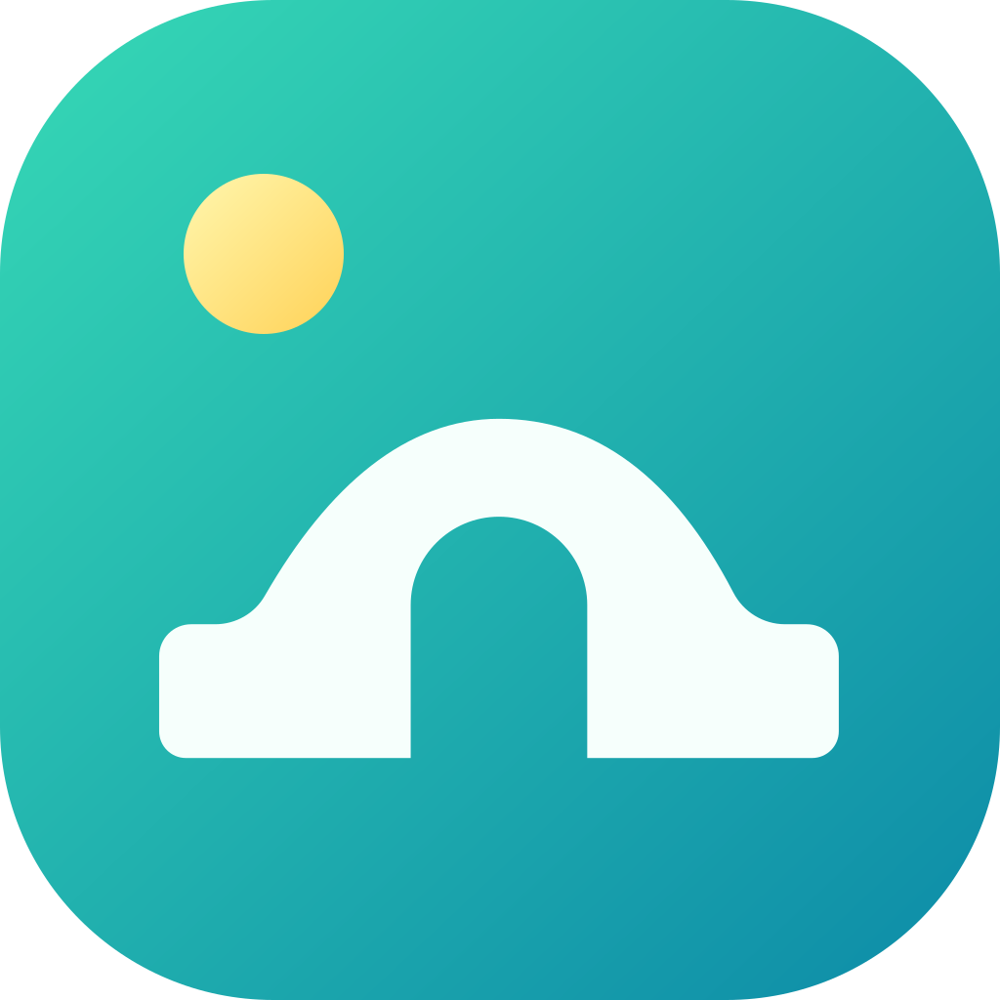

<div align="center">
  
  <h1>照片桥</h1>
  <p>
    给 Apple 相册打造的开放桥梁<br />
    让你的自定义工作流与 AI Agent 可以接管并智能整理你的相册
  </p>
</div>

## 🚀 快速开始

### 🟢 本地启动服务端

```bash
npm install
npm run dev:server
```

### 🐳 Docker 部署服务端

下载 `docker-compose.yml` 与 `.env.example`，配置好环境变量（主要是 `PUBLIC_BASE_URL` 和 `ADMIN_KEY`）后，启动 Docker 容器：

```bash
curl -O https://raw.githubusercontent.com/iBenzene/PhotosBridge/main/apps/server/docker-compose.yml
curl -o .env https://raw.githubusercontent.com/iBenzene/PhotosBridge/main/apps/server/.env.example

mv .env.example .env
vim .env # 修改 PUBLIC_BASE_URL 和 ADMIN_KEY

docker compose up -d
```

### 📱 连接 iOS 客户端

在浏览器中打开管理面板，登录后点击「＋ 添加设备」生成配对二维码。使用手机 App 前往「设置」👉「配对服务器」，扫描二维码即可完成配对 🎉。

### 🧰 接入工作流 / AI 智能体

完成配对后，即可通过 Python 工具库拉取照片元数据与缩略图，并结合多模态检索或 AI 模型制定相册整理方案。详细接入方式请参阅 **[Photos Bridge Toolkit 文档](apps/toolkit/README.md)**。
